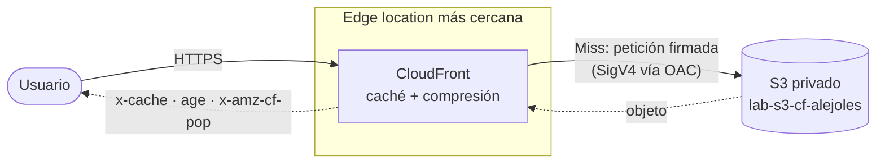

<div align="center">

# S3 + CloudFront

**Un sitio estático, privado y servido desde el edge.**


</div>

Laboratorio del taller de Commit Academy: una página estática alojada en un bucket de S3 **privado** y publicada mediante **CloudFront**. La propia página muestra, en vivo, cómo se comportó CloudFront con tu petición: si fue `Hit` o `Miss`, qué edge location respondió, cuánto lleva el objeto en caché y qué headers de seguridad recibió.

## Arquitectura



| Pieza | Decisión | Por qué |
|---|---|---|
| **S3** | Bucket privado, Block Public Access activado, sin *static website hosting* | El contenido nunca es público; el endpoint de website exige acceso público y no soporta OAC |
| **OAC** (Origin Access Control) | Firma las peticiones a S3 con SigV4 | Solo CloudFront puede leer el bucket |
| **Bucket policy** | `s3:GetObject` solo para `cloudfront.amazonaws.com` con condición sobre el ARN de la distribución | Ninguna otra distribución ni usuario puede leer los objetos |
| **CloudFront** | Redirección HTTP → HTTPS, compresión activada, `index.html` como *default root object* | HTTPS obligatorio y menos bytes por la red |
| **Páginas de error** | `403` y `404` sirven `/404.html` con código `404` | Con un bucket privado S3 responde `403` cuando falta un archivo, no `404` |

Más detalle, con el flujo de una petición paso a paso, en [`docs/architecture.md`](docs/architecture.md).

## La página

No usa frameworks, CDNs, fuentes remotas ni analíticas: HTML, CSS y JavaScript puros, todo del mismo origen, compatible con una CSP estricta (`default-src 'self'`).

Un navegador no puede leer los headers del documento que ya cargó, así que la página **repite la petición a su propia URL** y lee esa respuesta. Con ella muestra:

- **Estado de caché:** `Hit`, `Miss`, `RefreshHit` o `Error`, a partir de `x-cache`.
- **Edge location:** el PoP que respondió (`x-amz-cf-pop`).
- **Vida en caché:** `age` frente al TTL de `cache-control`.
- **Checklist de seguridad:** HSTS, `nosniff`, `X-Frame-Options`, `Referrer-Policy`, `Permissions-Policy` y CSP.
- **Experimento:** cinco peticiones seguidas con el tiempo de cada una, para ver el salto de `Miss` a `Hit`.

Si abres `index.html` directamente desde el disco (`file://`), muestra **SIN CLOUDFRONT** y no hace ninguna petición.

## Estructura

```
.
├── site/                    ← lo que se sube al bucket
│   ├── index.html
│   ├── 404.html
│   └── assets/
│       ├── css/styles.css
│       ├── js/app.js
│       └── img/favicon.svg
├── edge/                    ← CloudFront Function (headers de seguridad)
│   ├── viewer-response.js
│   ├── viewer-response.test.json
│   └── README.md
├── docs/
│   └── architecture.md      ← arquitectura en detalle
├── plan-implementacion-web-cloudfront.md
└── taller-s3-cloudfront.md
```

## Despliegue

El contenido de `site/` se sube a la **raíz** del bucket (`index.html` debe quedar en `/index.html`, no dentro de `site/`).

```bash
aws s3 sync site/ s3://<tu-bucket> --delete --profile <tu-perfil>
```

Si ya había una versión en caché, invalida para verla de inmediato:

```bash
aws cloudfront create-invalidation \
  --distribution-id <ID> --paths "/*" --profile <tu-perfil>
```

### Checklist de la distribución

- [ ] Origen: el endpoint **REST** del bucket (`<bucket>.s3.<región>.amazonaws.com`), con **Origin path vacío**
- [ ] Origin access: **OAC** con *Sign requests*
- [ ] Bucket policy limitada al ARN de la distribución
- [ ] **Default root object:** `index.html`
- [ ] Viewer protocol policy: *Redirect HTTP to HTTPS*
- [ ] **Error pages:** `403` y `404` → `/404.html`, respuesta `404`

## Verificación rápida

```bash
curl -sI https://<dominio>.cloudfront.net/ | rg -i 'x-cache|age|x-amz-cf-pop|via'
```

Pídela dos veces seguidas: la primera suele dar `Miss from cloudfront` y la segunda `Hit from cloudfront`, con `age` creciendo. Una ruta inexistente debe devolver la página 404 con código `404`.

## Seguridad

- El repositorio no contiene credenciales, ID de cuenta ni capturas sin revisar; el `.gitignore` excluye secretos, estado de Terraform y la evidencia sin tapar.
- El bucket nunca se hace público: toda lectura pasa por CloudFront.

---

<div align="center">
Hecho por <a href="https://github.com/Alejoles">Alejo</a> para el taller de Commit Academy.
</div>
