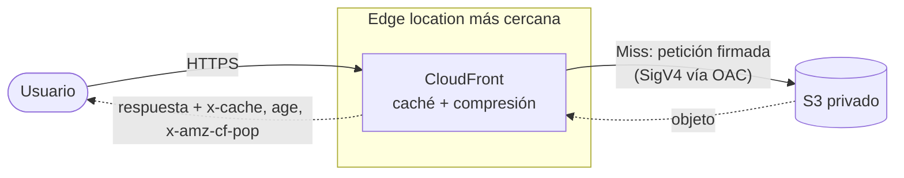
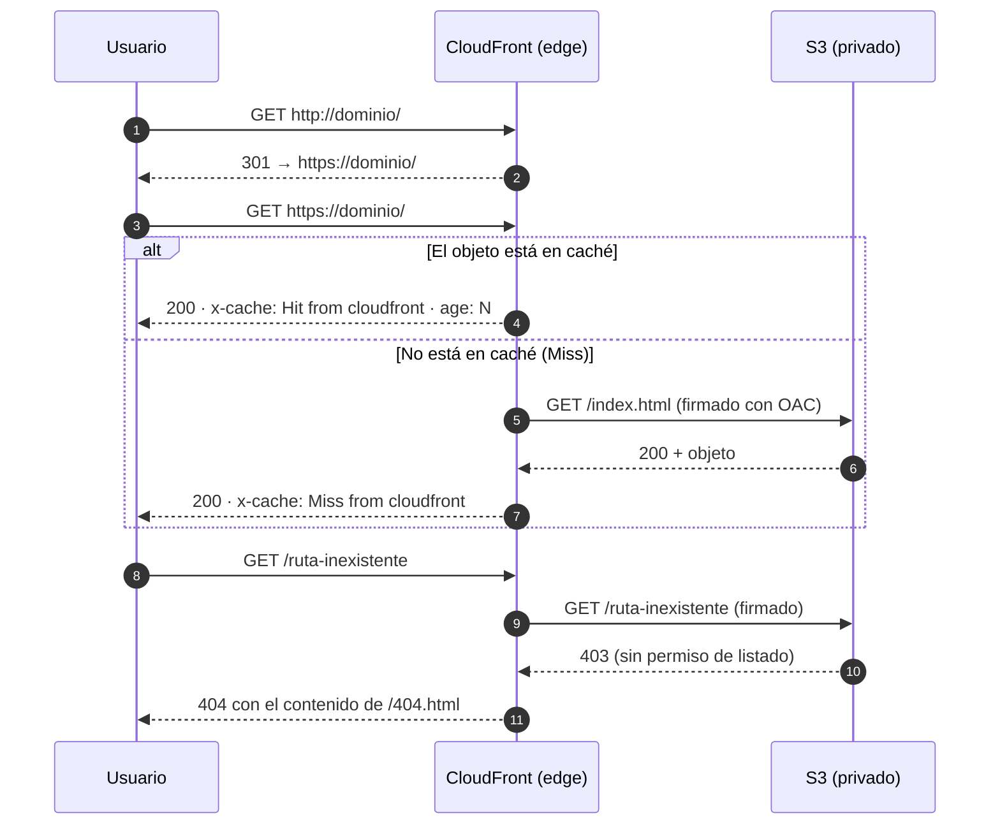

# Arquitectura

Un sitio estático en un bucket de S3 **privado**, publicado únicamente a través de CloudFront. Nadie puede leer el bucket directamente: solo la distribución, y solo con peticiones firmadas.

## Vista general



## Flujo de una petición



## Componentes

### S3

- Bucket **privado** con *Block Public Access* activado en sus cuatro opciones.
- Sin *static website hosting*: ese endpoint exige acceso público y no admite OAC. CloudFront usa el endpoint **REST** (`<bucket>.s3.<región>.amazonaws.com`).
- Cifrado en reposo con SSE-S3 (AES-256).

### Origin Access Control (OAC)

CloudFront firma cada petición al origen con SigV4 (`Sign requests`). S3 la acepta solo si la política del bucket autoriza a esa distribución.

### Bucket policy

Concede `s3:GetObject` al servicio `cloudfront.amazonaws.com` con una condición sobre el ARN de **una** distribución concreta:

```json
{
  "Effect": "Allow",
  "Principal": { "Service": "cloudfront.amazonaws.com" },
  "Action": "s3:GetObject",
  "Resource": "arn:aws:s3:::<bucket>/*",
  "Condition": {
    "StringEquals": {
      "AWS:SourceArn": "arn:aws:cloudfront::<cuenta>:distribution/<id>"
    }
  }
}
```

Sin esa condición, cualquier distribución de CloudFront de cualquier cuenta podría leer el bucket.

### CloudFront

| Ajuste | Valor |
|---|---|
| Origen | Endpoint REST del bucket, con *Origin path* vacío |
| Default root object | `index.html` |
| Viewer protocol policy | Redirect HTTP to HTTPS |
| Métodos permitidos | `GET`, `HEAD` |
| Compresión | Activada |
| Páginas de error | `403` y `404` → `/404.html`, con código `404` |

### Por qué 403 → 404

Si el bucket no concede `s3:ListBucket`, S3 responde `403` cuando falta un objeto, para no revelar qué claves existen. Sin la respuesta de error personalizada, el visitante vería el XML de `AccessDenied` en lugar de una página 404.

## Caché

- El TTL lo marcan los headers `cache-control` del objeto (`max-age` / `s-maxage`) dentro de los límites de la *cache policy*.
- `x-cache` indica el resultado: `Hit`, `Miss`, `RefreshHit` o `Error`.
- `age` son los segundos que lleva el objeto en la caché del edge.
- `x-amz-cf-pop` identifica el edge que respondió.
- Tras subir una versión nueva, invalida las rutas afectadas (`aws cloudfront create-invalidation`) o espera a que expire el TTL.

## Cómo la página lee todo esto

Un navegador no expone los headers del documento ya cargado. La página (`site/assets/js/app.js`) vuelve a pedir su propia URL, del mismo origen y con `cache: 'no-store'`, y lee los headers de esa respuesta. Por eso:

- La CSP puede ser `default-src 'self'`: no hay recursos externos.
- El valor de `x-cache` que muestra corresponde a **esa** petición, no a la primera carga.
- Abierta desde `file://`, la página no hace ninguna petición y muestra *SIN CLOUDFRONT*.

## Estructura del repositorio

```
site/        contenido que se sube a la raíz del bucket
docs/        documentación (este archivo)
```
